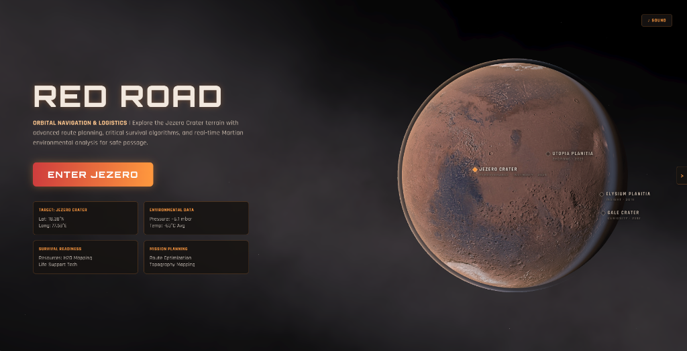
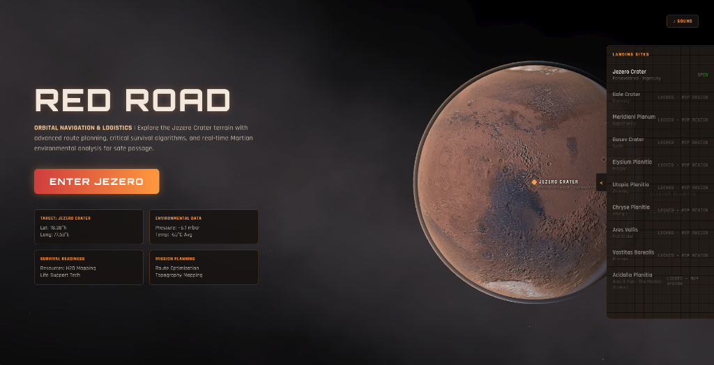
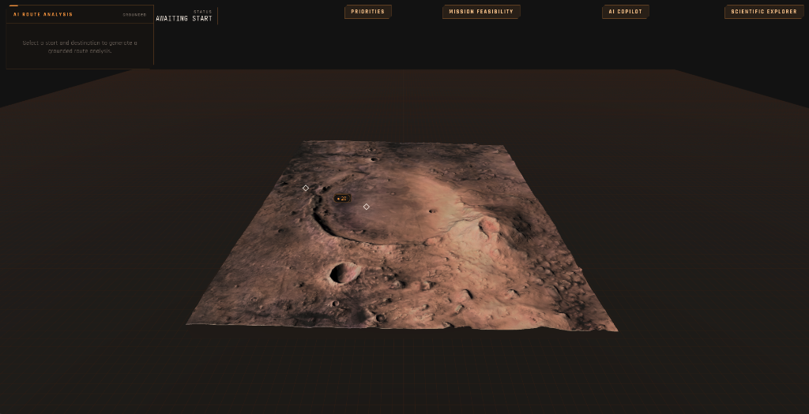
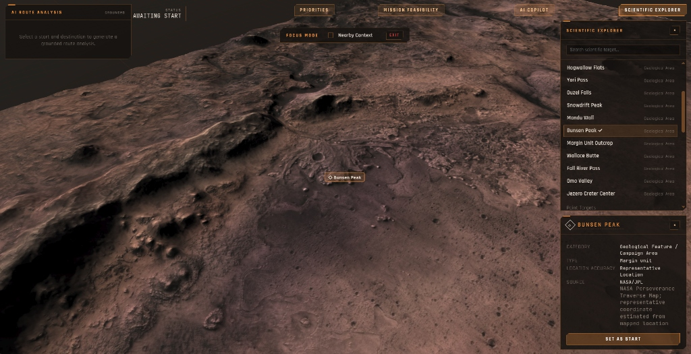
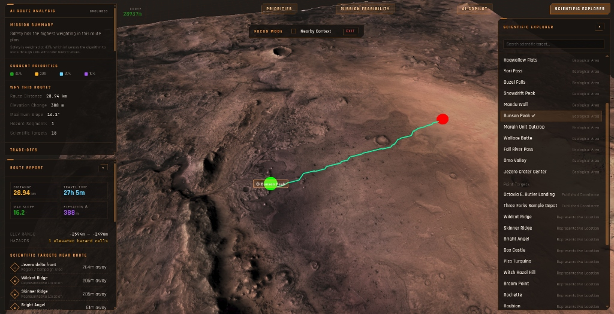
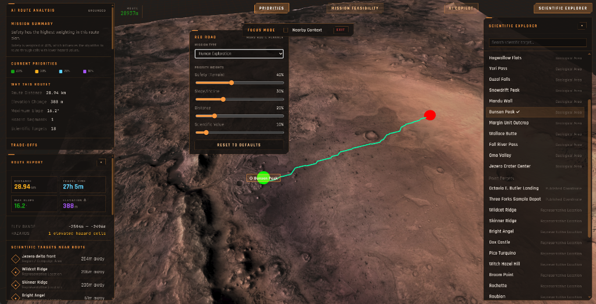
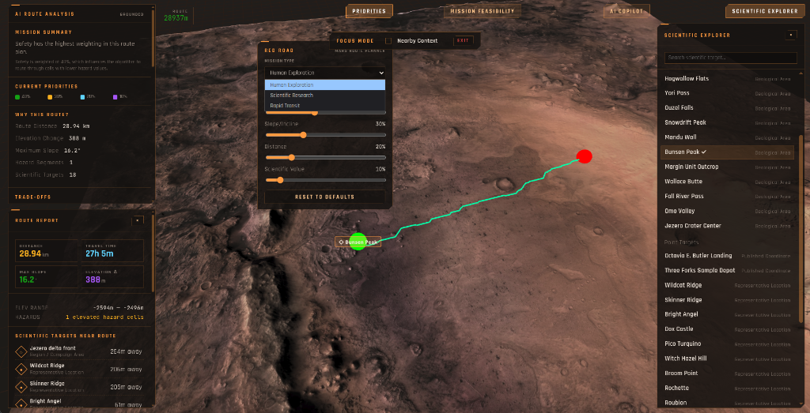
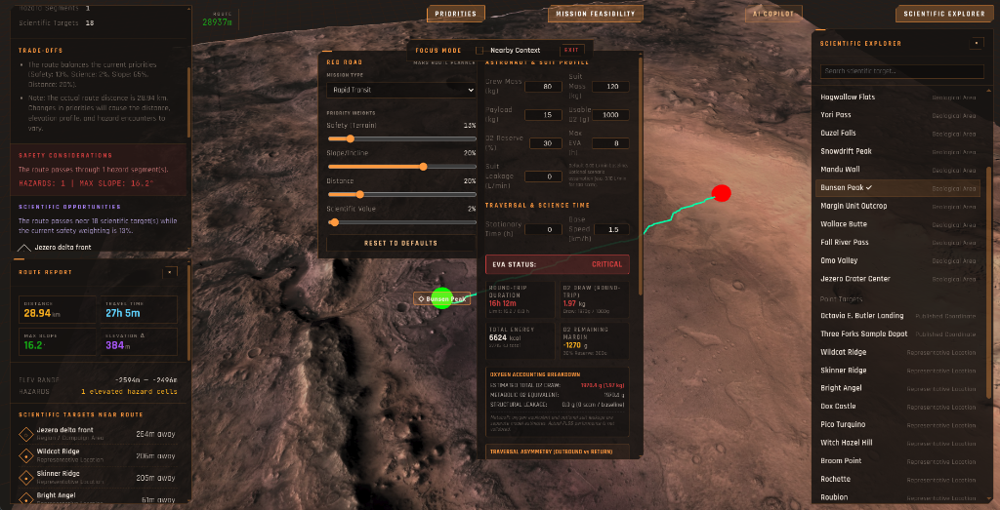
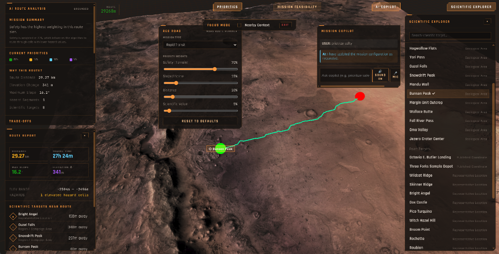

#  RED ROAD
### Autonomous Planetary Surface Navigation & Suited Bioenergetics Engine for Mars Exploration

[](https://www.spaceappschallenge.org/)
[](https://www.spaceappschallenge.org/)
[](https://red-road.vercel.app/)
[](https://red-road-production.up.railway.app)
[](https://github.com/tahaelbanna/Red-Road)
[](LICENSE)

---

##  1. Project Overview & NASA Space Apps Challenge 2026

**RED ROAD** is an interactive, scientifically grounded 3D surface navigation, terrain analysis, and astronaut bioenergetics system built for the **NASA Space Apps Challenge 2026** under the challenge:

> **"Interplanetary Survival Guide: Martian Map"**

### The Operational Challenge
When humanity sets foot on Mars, surface exploration will not happen in a featureless void. Astronauts conducting extravehicular activities (EVAs) within the rugged terrain of **Jezero Crater** (the landing site of NASA's *Perseverance* rover and *Ingenuity* helicopter) face an unforgiving environment:
- Extreme topographic relief with treacherous delta scarps, boulder fields, and steep crater walls.
- Strict Portable Life Support System (PLSS) consumable limits (metabolic oxygen, cooling water, battery capacity).
- Severe communication latency with Earth (4 to 24 minutes each way), making real-time ground control routing impossible.
- Asymmetric physical work: descending a 15° slope is easy, but ascending the same slope on the return leg consumes exponentially more energy and oxygen.

Traditional 2D satellite maps cannot ensure crew survival. Explorers require a **real-time, layered tactical navigation platform** that merges actual orbital science datasets, calculates deterministic safe routes, audits human physiological feasibility, and guarantees a safe return walkback before life-support reserves are exhausted.

### The RED ROAD Solution
RED ROAD transforms raw NASA orbiter telemetry into a high-fidelity 3D exploration and mission advisory engine:
1. **Photorealistic 3D Mars & Jezero Crater Terrain:** Interactive global Mars globe and high-resolution 1-meter equivalent Jezero Crater 3D mesh generated from NASA MRO CTX Digital Elevation Models (DEMs) and orthomosaics.
2. **Deterministic Multi-Objective A* Pathfinding:** Guarantees mathematically optimal traversal on an 8-connected grid balancing safety, slope, distance, and scientific value.
3. **Partial-Gravity Suited Bioenergetics Model:** Evaluates walking speeds, mechanical suit resistance, energy expenditure (kcal/kJ), and metabolic oxygen consumption rate based on a Mars-adjusted Minetti polynomial ($g = 3.72 \text{ m/s}^2$).
4. **Directional Safe Return & Walkback Feasibility Audit:** Verifies the reverse traverse ($\Delta z_{\text{return}} = -\Delta z_{\text{forward}}$) at every single waypoint to guarantee astronauts never cross a "Point of Safe Return" (PSR) past their mandatory 30% emergency reserve.
5. **AI Mission Copilot & Scientific Target Intelligence:** Natural language mission copilot powered by Gemini with deterministic intent fallback, contextualizing 37 peer-reviewed Jezero Crater geological features and rover campaign stops.

---

##  2. Visual Walkthrough & System Capabilities

### 2.1 Orbital Navigation & Global Mars View
The experience begins in orbital space, displaying a physically based 3D Mars globe textured with Viking MDIM 2.1 and MGS MOLA altimetry, complete with atmospheric scattering and orbital lighting.


*Figure 1: Global orbital reconnaissance dashboard showing planetary coordinates, atmospheric pressure, mean surface temperature, and landing site entry.*

---

### 2.2 Multi-Mission Landing Sites Selector
Crew commanders can browse and select primary Martian landing sites across exploration eras, from Viking and Pathfinder to Curiosity and Perseverance.


*Figure 2: Tactical landing site selection drawer highlighting the active high-resolution Jezero Crater exploration zone.*

---

### 2.3 High-Resolution Jezero Crater 3D DEM Terrain
Entering Jezero Crater transitions into a solid 3D terrain block constructed from real Mars Reconnaissance Orbiter (MRO) Context Camera (CTX) digital elevation data.


*Figure 3: Full 3D terrain mesh of Jezero Crater rendered in WebGL with directional sun lighting, crater morphology, and scientific target overlays.*

---

### 2.4 Scientific Explorer & Target Intelligence
The Scientific Explorer indexes 37 curated geological targets, rover sample depots, and campaign landmarks from NASA/JPL mission data. Selecting any target displays its geological category, provenance, and exact coordinates.


*Figure 4: In-depth inspection of Bunsen Peak (Margin unit outcrop) showing data provenance and "Set as Start" tactical routing integration.*

---

### 2.5 Deterministic Multi-Objective Route Planning
Clicking any start and destination point prompts the backend A* engine to compute the optimal route across the DEM elevation grid in milliseconds, rendering an interactive 3D traverse ribbon with real-time distance, slope, elevation change, and travel time telemetry.


*Figure 5: Planned 28.94 km EVA traverse between Bunsen Peak and the delta front, displaying 3D path geometry and proximity to 18 scientific targets.*

---

### 2.6 Dynamic Multi-Objective Priority Weighting
Commanders can adjust operational priorities using real-time sliders. The edge-cost function dynamically balances Terrain Safety, Slope Incline, Direct Distance, and Scientific Value.


*Figure 6: Custom mission priority configuration with real-time normalized sliders altering the pathfinding graph weights.*

---

### 2.7 Tactical Mission Archetypes
Preset mission profiles provide instant operational configurations tailored to specific EVA objectives:
- **Human Exploration:** Heavy emphasis on terrain safety (40%) and low slope (30%).
- **Scientific Research:** Maximizes proximity to geological outcrops and rover sample caches.
- **Rapid Transit:** Minimizes total distance and traverse duration for urgent resource transport.


*Figure 7: Mission profile selector switching between Human Exploration, Scientific Research, and Rapid Transit presets.*

---

### 2.8 Suited Bioenergetics, Oxygen Accounting & Safe Return Audit
The post-route bioenergetics advisory engine evaluates physiological feasibility for the active astronaut and suit profile, calculating metabolic oxygen consumption, structural suit leakage, round-trip duration, energy expenditure, and safe walkback viability.


*Figure 8: Mission Feasibility telemetry dashboard displaying EVA status (CRITICAL), round-trip oxygen draw breakdown, caloric expenditure (6,624 kcal), and emergency reserve breach alerts.*

---

### 2.9 Natural Language AI Mission Copilot
The integrated AI Copilot allows astronauts to interact using natural language or voice commands (e.g., *"prioritize safety"*, *"evaluate walkback feasibility"*), updating routing priorities and providing tactical summaries.


*Figure 9: AI Copilot interaction window providing explainable route analysis and real-time mission configuration updates.*

---

##  3. Scientific Models & Mathematical Formulation

RED ROAD maintains a strict separation of concerns between its **Phase 1 Protected Pathfinding Core** and its **Phase 2 Bioenergetics Advisory Engine**.

```
┌─────────────────────────────────────────────────────────────────────────────────┐
│                        SPATIAL PATHFINDING CORE (PHASE 1)                       │
│                                                                                 │
│   • 8-Connected DEM Grid (1013 x 891 cells, 100m horizontal resolution)         │
│   • Canonical Edge-Cost: Distance, Slope Penalty, Hazard Cost, Science Benefit  │
│   • Guaranteed Heuristic Admissibility: h(u) <= c*(u, v) (No overestimation)    │
└────────────────────────────────────────┬────────────────────────────────────────┘
                                         │ Optimal Waypoint Traverse
                                         ▼
┌─────────────────────────────────────────────────────────────────────────────────┐
│                     SUITED BIOENERGETICS ADVISORY (PHASE 2)                     │
│                                                                                 │
│   • Minetti (2002) 5th-Order Cost of Transport scaled to Mars Gravity (0.38g)   │
│   • Tobler Normalized Hiking Velocity Function for Sloped Marswalks             │
│   • Suited Metabolic Power: Locomotion + Basal Metabolic Rate + Suit Resistance │
│   • Total Oxygen Draw: Metabolic Consumption (1.936 g/kcal) + Structural Leak   │
│   • Asymmetric Directional Reverse Traverse & Point of Safe Return (PSR) Audit  │
└─────────────────────────────────────────────────────────────────────────────────┘
```

### 3.1 Canonical Edge-Cost Function (Pathfinding)
For each directed step between adjacent cells $u$ and $v$ on the DEM grid:

$$\Delta s_{3D} = \sqrt{\Delta x^2 + \Delta y^2 + \Delta z^2}$$

$$\text{Slope: } \theta = \arctan\left(\frac{|\Delta z|}{\sqrt{\Delta x^2 + \Delta y^2}}\right)$$

$$c(u, v) = \Delta s_{3D} \times \left(1 + w_{\text{slope}} \cdot f_s(\theta) + w_{\text{hazard}} \cdot H(v)\right) - w_{\text{sci}} \cdot B(v)$$

Where:
- $f_s(\theta)$: Non-linear slope penalty function preventing traversal on slopes exceeding $20^\circ$.
- $H(v)$: Terrain roughness and hazard index derived from satellite thermal inertia and slope variance.
- $B(v)$: Science benefit grid generated using exponential radial falloff ($R = 1000\text{m}$) around all 37 scientific targets:
  $$B(v) = \sum_{k=1}^{37} S_k \cdot \exp\left(-\frac{d(v, T_k)}{R_{\text{sci}}}\right)$$
- Admissibility condition: $c(u, v) \ge \Delta s_{\text{horizontal}} \cdot \kappa_{\min}$ guarantees that A* never overestimates distance to goal, ensuring shortest/safest paths.

### 3.2 Martian Partial-Gravity Cost of Transport (Minetti Model)
Human metabolic locomotion cost is computed using the empirical polynomial from **Minetti et al. (2002)**, scaled to the Martian gravitational field ($g_{\text{Mars}} = 3.72 \text{ m/s}^2$ vs $g_{\text{Earth}} = 9.81 \text{ m/s}^2$):

$$i = \tan(\theta) = \frac{\Delta z}{\Delta s_{\text{horizontal}}}$$

$$C_w(i) = \left(280.5 i^5 - 58.7 i^4 - 289.8 i^3 + 72.8 i^2 + 208.5 i + 46.5\right) \times \left(\frac{g_{\text{Mars}}}{g_{\text{Earth}}}\right) \quad [\text{J} \cdot \text{kg}^{-1} \cdot \text{m}^{-1}]$$

### 3.3 Tobler Marswalk Velocity Function
Traverse speed on sloped terrain is calculated using Tobler's empirical hiking formula normalized to a nominal suited Marswalk speed of $v_0 = 1.5 \text{ km/h}$ (or $0.417 \text{ m/s}$):

$$v(i) = v_0 \cdot \exp\left(-3.5 \cdot |i + 0.05|\right)$$

### 3.4 Suited Metabolic Power & Oxygen Accounting
Total power expenditure includes locomotion, basal metabolic rate, and pressurized EVA suit joint deflection resistance:

$$P_{\text{loco}} = C_w(i) \cdot M_{\text{total}} \cdot v(i) \quad [\text{W}]$$

$$P_{\text{total}} = P_{\text{loco}} + P_{\text{BMR}} + P_{\text{suit\_resistance}} \quad [\text{W}]$$

Total oxygen consumption is rigorously divided into **Metabolic Uptake** and **Structural Suit Leakage**:

$$\dot{m}_{\text{metabolic}} = P_{\text{total}} \times \left(\frac{1 \text{ kcal}}{4184 \text{ J}}\right) \times 1.936 \text{ g O}_2/\text{kcal} \quad [\text{g/s}]$$

$$\dot{m}_{\text{leakage}} = \text{suitLeakageRateLpm} \times \rho_{\text{O2}} \quad [\text{g/s}]$$

$$\text{Total } \text{O}_2 \text{ Draw} = \int_{0}^{T} \left(\dot{m}_{\text{metabolic}}(t) + \dot{m}_{\text{leakage}}(t)\right) dt$$

### 3.5 Asymmetric Directional Safe Return & Walkback Feasibility Audit
Marswalks must never become a one-way trip. The system audits reverse traversal feasibility at **every single waypoint** along the outbound route:
- Forward slope: $i_{\text{outbound}} = \frac{z_{k+1} - z_k}{\Delta s}$
- Return slope: $i_{\text{return}} = \frac{z_k - z_{k+1}}{\Delta s} = -i_{\text{outbound}}$
- Due to the steep non-linearity of $C_w(i)$, returning uphill after descending into a crater requires up to $300\%$ more oxygen.
- The **Point of Safe Return (PSR)** marks the exact geographic coordinate beyond which remaining life support cannot sustain the return leg while preserving the mandatory **30% Emergency Life Support Reserve**.

---

##  4. NASA Data Sources & Provenance

RED ROAD incorporates authentic, peer-reviewed planetary datasets provided by NASA, USGS, and international space science teams:

| Dataset / Instrument | Mission / Agency | Resolution / Coverage | Role in RED ROAD 2.0 | Provenance Reference |
| :--- | :--- | :--- | :--- | :--- |
| **Context Camera (CTX) DEM** | Mars Reconnaissance Orbiter (NASA/JPL) | 1-meter equivalent grid ($1013 \times 891$ cells) | High-resolution Jezero Crater 3D terrain mesh and elevation routing graph | NASA Planetary Data System (PDS) |
| **Context Camera (CTX) Orthomosaic** | Mars Reconnaissance Orbiter (NASA/JPL) | High-resolution visual albedo | Photorealistic surface texture mapping for Jezero Crater | USGS Astrogeology Science Center |
| **Mars Orbiter Laser Altimeter (MOLA)** | Mars Global Surveyor (NASA/GSFC) | 128 pixels/degree global altimetry | Global elevation displacement and topographic relief | NASA GSFC / PDS Geosciences Node |
| **Mars Digital Image Model (MDIM 2.1)** | Viking Orbiters 1 & 2 (NASA/USGS) | Global color visual mosaic | Global Mars 3D globe background albedo | USGS Astrogeology Science Center |
| **Thermal Emission Imaging System (THEMIS)** | 2001 Mars Odyssey (NASA/ASU) | 100m infrared daytime / nighttime | Thermal inertia and terrain hazard classification layer | ASU Mars Space Flight Facility |
| **Perseverance Traverse Map & Sample Depot** | Mars 2020 (NASA/JPL-Caltech) | Metric rover telemetry | 37 Curated scientific targets, sample caches, and geological units | NASA/JPL-Caltech Mars 2020 Mission |

---

##  5. Technical Architecture & Tech Stack

```
[ FRONTEND CLIENT ] ───────────────────────► [ BACKEND SERVER ]
• TypeScript / Vite / Three.js               • NestJS / TypeScript
• Physically Based WebGL Shaders             • Clean Architecture & DDD
• Interactive OrbitControls & Raycasting     • A* Heuristic Search Engine
• Responsive Glassmorphism HUD               • Mars Bioenergetics Model
• Real-time Sliders & Telemetry Charts       • Gemini 3.5 Copilot Service
• Audio Feedback & Voice Control             • Dual Port & Production CORS
```

### Frontend Architecture
- **Framework:** Vanilla TypeScript with Vite for ultra-fast bundling and minimal overhead.
- **3D Graphics Engine:** Three.js / WebGL with custom shaders for Mars atmosphere, normal mapping, and solid terrain elevation chunking.
- **UI Architecture:** Modular UI controllers (`feasibility.ui.ts`, `priorities.ui.ts`, `copilot.ui.ts`, `landingUI.ts`) with zero third-party UI framework bloat.

### Backend Architecture
- **Framework:** NestJS 12 running on Node.js 22 LTS with modular Domain-Driven Design (DDD).
- **Core Modules:**
  - `TerrainModule`: Loads and indexes DEM elevation matrices, coordinate transformations, and science benefit maps.
  - `RouteModule`: Executes canonical A* pathfinding with Dijkstra fallback and priority weighting.
  - `BioenergeticsModule`: Calculates suited metabolic rates, Tobler speed decay, oxygen accounting, and directional safe return.
  - `AIModule`: Gemini 3.5 Flash Lite natural language copilot with local deterministic intent parser fallback.
- **Testing & Quality Assurance:** Comprehensive test suite written with **Vitest** (65 backend tests, 15 frontend tests) and **Oxlint** for type-aware linting.

---

##  6. Quick Start & Local Development Guide

### Prerequisites
- **Node.js:** `v20.x` or `v22.x`
- **Package Manager:** `pnpm` (recommended) or `npm`
- **Git**

### Installation

1. **Clone the repository:**
   ```bash
   git clone https://github.com/tahaelbanna/Red-Road.git
   cd Red-Road
   ```

2. **Setup and run the Backend:**
   ```bash
   cd backend
   pnpm install
   pnpm run build
   pnpm test
   pnpm run start:dev
   ```
   *The backend will be running on `http://localhost:3000`.*

3. **Setup and run the Frontend:**
   ```bash
   cd ../frontend
   pnpm install
   pnpm test
   pnpm run dev
   ```
   *Open your browser and navigate to `http://localhost:5173`.*

### Environment Variables (Optional)
In `backend/.env`:
```env
PORT=3000
FRONTEND_URL=http://localhost:5173
GEMINI_API_KEY=your_gemini_api_key_here  # Optional: Enables cloud LLM copilot; otherwise deterministic local copilot is used
```

In `frontend/.env`:
```env
VITE_BACKEND_URL=http://localhost:3000
```

---

##  7. Quality Assurance & Verification Baseline

RED ROAD has been subjected to rigorous automated verification:

| Test Suite | Framework | Total Tests | Status | Execution Time |
| :--- | :--- | :--- | :--- | :--- |
| **Backend Route & Pathfinding Unit Tests** | Vitest | 9 tests | ✅ PASS | ~30ms |
| **Backend Bioenergetics & Minetti Tests** | Vitest | 26 tests | ✅ PASS | ~180ms |
| **Backend Science Benefit & Coordinates** | Vitest | 8 tests | ✅ PASS | ~25ms |
| **Backend Route Use Cases & Priorities** | Vitest | 18 tests | ✅ PASS | ~100ms |
| **Backend AI Copilot Integration Tests** | Vitest | 4 tests | ✅ PASS | ~10ms |
| **Frontend Feasibility UI Validation Tests** | Vitest | 7 tests | ✅ PASS | ~10ms |
| **Frontend Scene Coordinates & Config Tests**| Vitest | 8 tests | ✅ PASS | ~15ms |
| **Total Automated Tests** | | **80 / 80 Passing** | **100% Pass Rate** | **~1.8s** |

---

##  8. Production Deployment & Live Demo

The RED ROAD system is deployed in a high-availability production cloud environment and accessible publicly:

###  Live Production Links
- **Interactive 3D Web Application (Frontend):**  
   **[https://red-road.vercel.app/](https://red-road.vercel.app/)**  
  *Hosted on Vercel Edge Network with worldwide CDN caching.*

- **Production REST API & Engine (Backend):**  
   **[https://red-road-production.up.railway.app](https://red-road-production.up.railway.app)**  
  *Hosted on Railway Cloud running containerized Node.js 22 LTS.*

- **API Health & Telemetry Status:**  
   **[https://red-road-production.up.railway.app/health](https://red-road-production.up.railway.app/health)**  
  *Returns `{"status":"ok","uptime":...,"timestamp":...}` to confirm live availability.*

---

##  9. NASA Space Apps Challenge 2026 Submission Team

- **Author & Lead Developer:** Taha Elbanna
- **Author & Lead R&D** Abdelrahman Taha
- **Event:** NASA International Space Apps Challenge 2026
- **Challenge:** Interplanetary Survival Guide: Martian Map
- **Repository:** [https://github.com/tahaelbanna/Red-Road](https://github.com/tahaelbanna/Red-Road)

*Ad Astra per Aspera — To the Stars through Hardship.*
